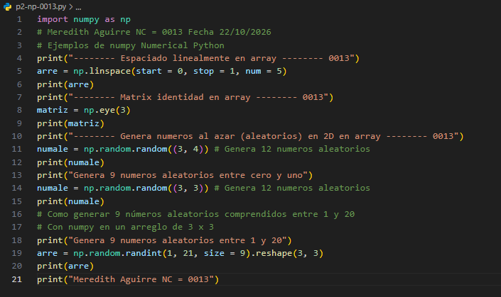
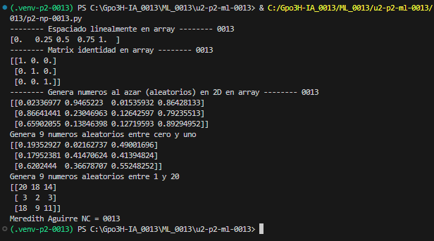

1. **start = 0:** Indica el valor inicial de la secuencia.
2. **stop = 1:** Indica el valor final de la secuencia.
3. **num = 5:** Indica la cantidad de valores que se van a generar.

# Conceptos de np.linspace()
**linspace:** Es una función de NumPy que genera una cantidad determinada de valores distribuidos uniformemente entre un valor inicial y uno final.

## El Codigo 

## Resultado
